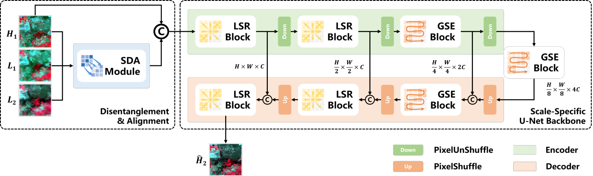

# DSDF

**DSDF: A Disentangled Spatiotemporal Data Fusion Model with Scale-Specific Representation**

Chen Xu, Xiaoping Du, Hongdeng Jian, and Xiangtao Fan

DSDF predicts a fine-resolution multispectral image at a target date using one fine/coarse image pair from a reference date and one coarse image from the target date. Single-shot Disentangled Alignment (SDA) combines the three observations. The encoder and decoder use Local Spatial-spectral Representation (LSR) at finer scales and Global State-space Evolution (GSE) at coarser scales.



[Installation](#installation) · [Inference](#inference) · [Paper results](#paper-results) · [Training](docs/training.md) · [Citation](#citation)

## Installation

We tested DSDF on Linux x86-64 with Python 3.10, PyTorch 2.5.1, CUDA 12.1 and an NVIDIA A100. Clone the repository and create a Python environment:

```bash
git clone https://github.com/ChenXuAxel/DSDF.git
cd DSDF
python3.10 -m venv .venv
source .venv/bin/activate
```

Install the CUDA 12.1 build of PyTorch, then the reference dependencies and DSDF. The requirements file selects official prebuilt Mamba and causal-conv1d wheels for CPython 3.10 on Linux x86-64 and verifies their SHA-256 hashes. This path requires an NVIDIA driver compatible with CUDA 12.1 and access to PyPI, the PyTorch wheel index, and GitHub release assets.

```bash
python -m pip install pip==25.1
python -m pip install torch==2.5.1 --index-url https://download.pytorch.org/whl/cu121
python -m pip install -r requirements/linux-cu121-py310.txt -e '.[geotiff]'
python -m pip check
python examples/inference.py
```

The last command runs a six-band forward pass with random weights and prints `Predicted fine image: (1, 6, 64, 64)`. These wheel files are specific to the Python, Linux architecture and PyTorch build above. Other configurations need compatible extension builds.

## Inference

### Predict a GeoTIFF patch

Supply a trained checkpoint and three floating-point reflectance patches. The weights and imagery in the command below are user-supplied files. Both coarse images must already be resampled onto the fine grid. Use the same band order, scale reflectance to [0, 1], and resolve missing pixels before inference. Height and width must each be divisible by eight.

| Input | Date | Observation |
| --- | --- | --- |
| `HR_t1.tif` | Reference | Fine image |
| `LR_t1.tif` | Reference | Coarse image on the fine grid |
| `LR_t2.tif` | Target | Coarse image on the fine grid |

```bash
python examples/predict.py \
  --weights cia.ckpt \
  --fine-reference HR_t1.tif \
  --coarse-reference LR_t1.tif \
  --coarse-target LR_t2.tif \
  --output predicted_t2.tif
```

The [GeoTIFF example](examples/predict.py) accepts a plain DSDF `state_dict` or a Lightning checkpoint containing `model.*` weights. Choose a new output path. The saved float32 GeoTIFF uses the fine reference grid and band order. Its values are raw reflectance predictions and can fall outside [0, 1].

We ran the GeoTIFF example twice in a fresh Python 3.10.18 environment on an A100 (driver 535.161.08), using the trained CIA checkpoint and the same 512 × 512 six-band patch. Compared with the archived prediction, the maximum absolute reflectance difference was 0.0001494 on the first run and zero on the second. On valid pixels, the first run changed the pooled RMSE by 1.47 × 10⁻⁸. These checks cover one patch.

To run the GeoTIFF and checkpoint tests locally, use `python -m unittest discover -s tests -v`.

### Use DSDF from Python

For a plain `state_dict`, load the model as follows. Pass the three CUDA tensors in the order shown, each shaped `(batch, bands, height, width)`. Set `in_channels` to the band count used to train the checkpoint.

```python
import torch
from dsdf import DSDF

model = DSDF(in_channels=6, use_checkpoint=False)
weights = torch.load("dsdf_state_dict.pt", map_location="cpu", weights_only=True)
model.load_state_dict(weights)
model.cuda().eval()

with torch.no_grad():
    fine_target = model(fine_reference, coarse_reference, coarse_target)
```

## Paper results

Table 3 of the manuscript reports the following results for DSDF. Lower RMSE, ERGAS and SAM are better. Higher PSNR, SSIM and CC are better.

| Dataset | RMSE ↓ | ERGAS ↓ | SAM ↓ | PSNR ↑ | SSIM ↑ | CC ↑ |
| --- | ---: | ---: | ---: | ---: | ---: | ---: |
| CIA | 0.0241 | 0.2490 | 0.0625 | 32.4424 | 0.8898 | 0.9699 |
| LGC | 0.0201 | 0.2018 | 0.0526 | 34.1685 | 0.9379 | 0.9786 |
| DX | 0.0334 | 0.3776 | 0.0976 | 29.6378 | 0.7934 | 0.9550 |
| TJ | 0.0388 | 0.5001 | 0.1223 | 28.3812 | 0.7724 | 0.9397 |

The [training notes](docs/training.md) give the patch size, optimizer, learning-rate schedule and a minimal PyTorch training loop.

## Citation

If you use DSDF in your research, please cite *DSDF: A Disentangled Spatiotemporal Data Fusion Model with Scale-Specific Representation* by Chen Xu, Xiaoping Du, Hongdeng Jian, and Xiangtao Fan. GitHub’s **Cite this repository** menu uses the [citation metadata](CITATION.cff).

## Acknowledgments and license

Our experiments use the spatiotemporal fusion benchmark described by Sun et al. GSE uses Mamba-2 with four-direction scanning adapted from VMamba. [Benchmark paper](https://doi.org/10.1016/j.inffus.2025.103675) · [Mamba](https://github.com/state-spaces/mamba) · [VMamba](https://github.com/MzeroMiko/VMamba)

DSDF code is released under the Apache License 2.0. See the third-party notices for the VMamba and timm components. The architecture diagram is Figure 2 from the manuscript. [License](LICENSE) · [Third-party notices](THIRD_PARTY_NOTICES.md)
